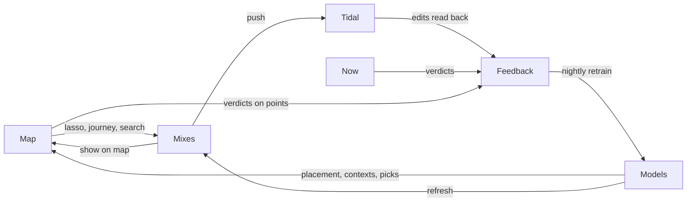

# Catalogue, map and mixes: interface plan

17 Oct 2026 · @George · follows [PLAN.md](PLAN.md), and replaces the outline of its phases 3–5

The catalogue as a place you move through, not a list. A home for every mix, kept in sync with Tidal and wired into feedback. Show a lot of data, but only one layer at a time, with detail on demand.

## Built: the Catalogue rework (31 Oct 2026)

From the approved canvas "Catalogue page layouts" (A–D and the rest of the pages). The library leads with when as well as how much.

- **Library home** (`pages/CataloguePage.kt`): one search for everything; the catalogue split by when you last played each track (lately = the last 45 days, earlier this year, before this year, never) as a bar with counts; "You've been in lately" (albums, sets, the busiest context, with colour icons); a door to each part.
- **Tracks (A)**: the four parts as filters, each sorted its own way (most played lately; last played; most played then, tagged with the peak year; never played, closest to your contexts first and saying what each sounds like). Rows have colour icons, "7 lately · 18 in all · last 27 Oct" and age tags.
- **Artists (B)**: a bar per year from 2016, the peak in the Era colour and this year in the Now colour; NOW when this year is at least half the peak year, else the peak year. Sorted by this year or all time.
- **Artist (C)**, **Album**, **Set**, **Context (D)** and **Track** pages, and **Search** over every kind with jump chips, the best match as a card, and "All N" links. Sections use Discover's kicker, big title and rows in a card.
- **Map, calm**: families as soft regions (a blurred density field per family, drawn once into a small bitmap per Show option); tap one to see its tracks as dots in their contexts' colours, up to four contexts named and the list of them with age tags; tap a context for its page. Show: All, Lately (bigger dots), Faded, Unplayed (hollow). No animation but the frame gliding to a family. The old colour modes, list rings and search on the map are gone.
- **Server** (`api/library.py`): `/library/summary`, `/library/tracks?when=`, artists with plays per year, albums with played/unplayed and per-track colours, sets with a tracklist strip, pages for each, `/library/search`. `NearContext` stores each track outside a context with the context it sounds closest to, nightly after the map (`recommend.atlas.near_contexts`); `/map` points carry recency flags, a near hue and a family; `/map/version` lets the app download the map only when it changes (checked at most hourly).

## What there is to show

Measured on the server today:

| Data | Count | Where it goes |
|---|---|---|
| Tracks | 40,923 | The map's points |
| With a sound profile (Essentia + CLAP) | 22,800 | Full points: sigil, sound search |
| With a fused sound-and-listening vector | 21,096 | Placement on the map |
| Session vectors (how you play them together) | 24,068 | The "Listening" layout |
| Contexts / families | 54 / 13 | Regions / continents |
| Context members | 7,498 | The cores of the regions |
| Plays / sessions | 137,890 / 7,923 | History, eras, the time layout |
| Similar-track / similar-artist links | 370k / 445k | Graph walks, the frontier |
| Releases in the queue, sets | 93, 415 | Glowing points at the edges |
| Recommendations logged (with reason and outcome) | 3,832 | Mix stats, "suggested before" |
| Favourites | 3,659 | Bright points |

Tracks without a sound profile, about 18k (mostly one-off plays), go on the map as faint ghosts. Each sits by its artist's or session neighbours until enrichment reaches it.

## Design principles

1. **One map, many lenses.** Every track is a point, always in the same place. What changes is what the points encode (the lens) and how they're laid out (the layout). You learn one picture and read it many ways.
2. **One encoding at a time.** Colour means one thing at a time, and the legend says what. Nothing runs on two scales at once.
3. **A context has one colour everywhere.** It's the same on its map region, tile, mix, sigil, notification and Tidal cover. Colour is the thread between screens.
4. **Detail on demand, in three steps.** A peek line, then a half sheet of key facts, then the full page. Nothing appears that you didn't ask for, and everything is one more tap away.
5. **Every number has a picture.** BPM is ticks, energy a bar, history a sparkline, fit a ring. Numbers sit beside the pictures in the mono face, never alone.
6. **Search, filters and feedback all show on the map.** A search lights up points; a filter dims the rest; a verdict recolours a point. The map is the live state of everything.
7. **Fast on a DAP.** The GPU draws positions and colours; Compose draws only text and sheets. Nothing animates that isn't moving.

## Navigation

The spaces become **Now · Map · Mixes**. Jobs moves behind a server-status chip in the top bar (a green dot when the worker is up; tap for the Jobs screen as built). The dock stays on every screen.

```
┌──────────────────────────────────┐
│ [ Now | Map | Mixes ]   ● ⚙      │  ● = server/worker status → Jobs
│                                  │
│           (space)                │
│                                  │
│ ◉ Track — Artist          ⏸ ✓ ✕  │  dock
└──────────────────────────────────┘
```

The Discover deck from PLAN.md phase 4 becomes the **Fresh** mix's own view (see Mixes). Its candidates also glow on the Map's frontier, so discovery lives in both places rather than in a fourth space.

## The Map

A full-screen canvas of every track. The rest of this section covers how it looks, how you use it, and how you move through it.

### Zoom levels

The same points read differently at each zoom level (semantic zoom).

| Zoom | You see | Labels |
|---|---|---|
| Out | 13 **continents** (families) as soft-tinted shapes, points as density | Family names ("House / Tech House") |
| Middle | 54 **regions** (contexts), with outlines, era years and size | Context names, plus a mini energy bar |
| In | Individual points: favourites bright, canon ringed, queue glowing, ghosts faint | Artist names on the bigger points |
| Closest | Points become small sound sigils; tapping one opens its peek line | Track titles |

Labels never overlap. A label is placed only if it doesn't collide with one already drawn, biggest region first, so the screen stays clean at every zoom.

### Lenses: what colour and size mean

A lens strip sits along the bottom edge, one tap per lens; long-press a lens to filter by it. Each lens has a one-line legend.

| Lens | Colour | Size | Answers |
|---|---|---|---|
| **Context** (default) | Context hue | Recent plays | Where's what, and what am I into |
| **Era** | Peak listening year (cool for old, warm for new) | Peak plays | What did I play when |
| **Energy** | Energy 0–1 | Danceability | Where's the calm, where's the peak |
| **Mood** | Dominant mood (happy, party, aggressive, sad, relaxed) | Strength | What it feels like |
| **Key** | Camelot position | BPM | What mixes into what |
| **Verdicts** | Keep, No, Not now, Never, favourite | Recency | What I've judged, and what's untouched |
| **Discovery** | New in the queue, never played, played once, played often | Fit score | Where the unexplored is |
| **Outcomes** | Suggested-and-played vs. suggested-and-ignored | Times suggested | Whether the recommender works here |

### Layouts: where the points sit

The innovative part. The same points fly between layouts in about 600 ms. The GPU blends two position buffers, so the change is cheap and the animation shows you how the views relate.

| Layout | Axes | Computed | Shows |
|---|---|---|---|
| **Taste** (default) | UMAP of the fused vectors | Server, nightly | Sound and listening together: your clusters |
| **Sound** | UMAP of the Essentia embeddings | Server, nightly | What sounds alike, however you play it |
| **Listening** | UMAP of the session vectors | Server, nightly | What you play together, whatever it sounds like |
| **Time** | x = peak listening date, y = family band | Device | Your history as a river; eras as streams that start and stop |
| **Feel** | x = energy, y = mood valence (happy − sad) | Device | Two axes you can read without a key |
| **Wheel** | Angle = Camelot key, radius = BPM | Device | A DJ view: what mixes into what, at what tempo |

Flicking between Sound and Listening shows the gap between how things sound and how you use them. Tracks that jump far are the interesting ones, and a "biggest movers" list sits under that toggle.

### Moving and acting on the map

| Gesture | Does |
|---|---|
| Pinch, pan, double-tap | Zoom and move |
| Tap a point | Peek line: sigil, title, artist, context, BPM and key, with Keep and No |
| Tap a region label | Region sheet (see below) |
| Long-press and drag | **Lasso**: the selected tracks become a draft mix (see Mixes) |
| Tap two points, then **Journey** | A path from A to B through the neighbour graph, as an energy arc; drawn as a line, offered as a mix |
| **Follow** (the now-playing pulse) | A pulse marks the playing track; the camera follows it, leaving a trail of today's session |
| Year scrubber (Time lens or layout) | Points fade in by peak date; "Play this era" at any year |

### Frontier and gaps

Two overlays that turn the map into discovery:

- **Frontier.** Candidates you've never played (Tidal similar tracks, queue releases, sets' tracklists), placed by their sound and glowing just outside the regions they'd join. Tap one to hear its preview. Keep pulls it into the region.
- **Gaps.** Thin areas between two regions you play, marked as dashed bridges. Tapping one offers a bridge mix of tracks that sit between those regions.

### Search: one bar, results on the map

One bar at the top of Map (and the ask bar on Now) takes anything:

| You type | It's read as | The map |
|---|---|---|
| "Prospa", "Defected", "Kerri Chandler remix" | Names: artist, track, label, remixer | Matches light up; the camera fits them |
| "hypnotic rolling no vocals" | Sound, via a CLAP text embedding | A heat glow over where it sounds like that |
| "summer 2019", "2016 not since" | Time travel | That period's tracks light up; the rest dims |
| "122–126 bpm 8A instrumental" | Filters, shown as chips | Points outside the filters dim |
| A mix of these | Combined, as `ask` does now | All of the above at once |

Results come as both a list (half sheet) and lit points. Switching between them keeps the selection. Any result set can become a mix with **Make a mix**.

Offline, name search runs on the device against the cached track index (Room FTS), and filters run on the cached attributes. Sound and time search need the server; the bar says so.

## Region sheet (a context)

Opens from a region label, a context tile on Now, or a track's context chip. The colour band across the top is the context's hue.

```
┌──────────────────────────────────┐
│ ▬▬▬▬▬▬▬▬▬▬ (context colour) ▬▬▬▬▬ │
│ House: Dom Dolla       412 tracks│
│ 2019–2024 · 124–128 BPM · ▮▮▮▯ energy
│                                  │
│  hour × weekday heatmap          │ when you play it
│  plays per month sparkline       │ how it's trending
│                                  │
│ Top artists · top styles         │ chips
│ Core ←──────────────→ Edge       │ members sorted by distance to centre
│                                  │
│ Mix: synced to Tidal · 40 · 2 h ago  [Open] [Sync ⟳]
│ Novelty  ──●────── 35%           │
│ Rename · Merge · Split · Move tracks
└──────────────────────────────────┘
```

**Core → edge** is the most useful list in the app. It shows the tracks that define the context first, and the outliers last. Outliers are where you correct the clustering: swipe one to another context, or say No.

## Track page

Shown as a peek line, then a half sheet, then the full page.

- **Peek:** sigil, title, artist, context chip, BPM and Camelot, the verdict buttons.
- **Half:** a large sigil (the mood lobes labelled), energy and danceability bars, whether it has vocals, the **why it's here** line (the nearest context and its distance, plus its strongest neighbours), and plays with a sparkline that marks its peak.
- **Full:**
  - **Neighbours** in three tabs: Sound, Listening and Platform similar. Each is a short list that also lights up on the map.
  - **History:** first heard, peak, last played, and which sessions it opened or closed.
  - **Suggested before:** each time it was recommended, with the mix, the reason and the outcome.
  - **Credits:** label, remixers and releases, each a tappable chip that becomes a search.
  - **Actions:** open in Tidal, start a mix from it, add to a mix, move to another context.

## Mixes: the home for playlists

Every list the server makes is a **mix**: an object with a recipe, tracks, reasons, stats, a Tidal link and feedback.

### Kinds of mix

| Kind | Source | Refresh |
|---|---|---|
| Context | One per active context (existing) | Daily |
| Rotating eras | Past-era and dormant contexts (existing) | Weekly |
| Fresh | The release queue (existing) | Fridays |
| Rediscovery | Faded peaks (existing) | Weekly |
| Edges and bridges | The frontier, and gaps between regions | Weekly |
| Asked | A search or request turned into a mix | Once, or on a schedule you set |
| Drawn | A lasso, a journey, a graph walk | Once |
| Pinned | Any mix you've frozen | Never; your edits stick |

### The Mixes space

```
┌──────────────────────────────────┐
│ Search mixes…           [Synced ▾]│
│                                  │
│ PINNED                           │
│ ▌Friday warm-up   40 · 2 h  ⟳ ●  │  ▌ = colour strip from its contexts
│                                  │
│ FOR YOU                          │
│ ▌House: Dom Dolla  40 · today ⟳ ●│  ● synced to Tidal   ○ not synced
│ ▌Fresh             28 · Fri   ⟳ ●│  ⟳ auto-refresh
│ ▌Rediscovery       40 · Mon   ⟳ ○│
│ ▌Edges             30 · Mon   ⟳ ○│
│                                  │
│ DRAWN AND ASKED                  │
│ ▌Journey: Slow Sunday → Peak  24 │
│ ▌"dubby, nothing vocal"       30 │
└──────────────────────────────────┘
```

Each row shows:
- a **colour strip**: the mix's context mix as proportional bands, so you see what it's made of at a glance;
- a **sync dot**;
- a **played-through ring** (the share of its tracks you went on to play, from the recommendation log): a quiet score for how well the mix works.

### A mix's page

```
┌──────────────────────────────────┐
│ House: Dom Dolla                 │
│ 40 tracks · 2 h 41 m · 35% new   │
│ ▁▂▃▅▆▇█▇▆▅▄▃ energy arc         │ energy and BPM per position;
│ 8A→8A→9A→9B…  key path           │ breaks between incompatible keys in red
│                                  │
│ Tidal ● synced 2 h ago · 3 not on Tidal
│ [Play in Tidal] [Sync now] [Pin] │
│ ★★★★☆  too safe · great for the car
│                                  │
│ 1 ◉ Track — Artist    new · same label as X   ✓ ✕
│ 2 ◉ …                                       │ swipe right Keep, left No
│ …                                │
│ [Show on map]                    │ draws the mix as a path through its points
└──────────────────────────────────┘
```

- **Energy arc and key path:** the shape of the mix, drawn from the data the sequencer already uses.
- **Show on map:** the mix's tracks light up and are joined in play order, so you see its route through your taste: whether it stays in one region or travels.
- **Reasons** on each row come from `explain()` as they do now, in the caption style.
- **Editing:** reorder, remove (counts as No for this mix) or add from search. An edited mix is pinned automatically, so the next refresh doesn't overwrite your changes.

### Two-way sync with Tidal

What exists: `push_playlist` creates an unlisted Tidal playlist, reads its current items, and replaces them. What's added:

| | Behaviour |
|---|---|
| **Per-mix switch** | Synced or not. Context mixes for your top contexts default to on; the rest default to off. |
| **Read back before each push** | Before replacing, diff the playlist's current items with what was pushed last time:<br>• tracks you removed in Tidal become `no` verdicts for that mix (`source="tidal"`, `where="mix:<key>"`);<br>• tracks you added become `yes` verdicts and seed the next refresh. |
| **Pinned mixes** | Never replaced. They're read back only, so Tidal edits still count as feedback. |
| **Naming** | Synced playlist titles keep the existing "Audio Brain · " prefix, so they group together in Tidal. The description holds the recipe and the top reasons. |
| **Missing on Tidal** | Tracks without a Tidal ID are counted ("3 not on Tidal") and listed, never dropped silently. |
| **Status** | Last pushed, last read, tracks changed, and any error; shown on the mix and in Jobs. |
| **Offline on the DAPs** | Synced mixes are what you mark for offline in Tidal. The app shows which synced mixes changed since the DAP last connected, so you know what to refresh. |

This makes Tidal itself a feedback surface. Editing a playlist on the DAP, in the Tidal app, teaches the model as much as tapping a verdict here.

## How it all connects



A verdict given anywhere recolours its point on the Verdicts lens straight away (from the local outbox, before it syncs), and updates the mix row it was given in.

## Offline on the DAPs

| Works offline | Needs the server |
|---|---|
| The map: all layouts, lenses, zooming, the track peek and half sheet | Sound search, time travel, journeys, bridges |
| Name search and filters (on-device index) | Previews |
| Every cached mix: tracks, reasons, arc, open in Tidal | Making new mixes, sync and refresh |
| Verdicts, mix ratings, mix edits (queued in the outbox) | Region edits take effect once synced |

**Cache budget, about 10 MB:**
- the point buffers: 21k points × 3 learned layouts × 4 bytes ≈ 250 KB;
- attributes per point: context, peak year, energy, mood, key, BPM, flags (16 bytes each) ≈ 650 KB;
- the track index with FTS ≈ 6 MB;
- region outlines and labels ≈ 100 KB;
- mixes ≈ 1 MB.

The three device-computed layouts come from the attributes, so they cost nothing to sync.

## Rendering

- OpenGL ES 3.0 (AGSL needs Android 13, and the plan supports Android 10 up).
- One instanced draw for all points.
- **Vertex shader:** blends two position buffers by `t` (the layout morph) and looks up colour from the lens attribute in a small palette texture, so switching lens only changes a uniform.
- **Selection mask:** search hits, filters and lassos are a byte per point, uploaded as a buffer; dimming and glow happen in the shader.
- **Regions:** contour polygons from the server (per-context density at one level), drawn as filled translucent meshes behind the points.
- **Hit-testing:** a uniform grid on the CPU, rebuilt only when the layout changes.
- **Labels:** Compose text over the GL surface, culled by zoom and collision.
- **Frame budget:** draw only while moving or animating. At rest the last frame stays, so battery use is close to zero.
- **Measured on the JM21 and M23 in phase 0:** a 40k-point morph at 60 fps is the target. If the frame rate drops, ghosts are thinned at low zoom (level of detail).

## Server work

1. **Projection job** (a new step in the Models job):
   - UMAP to 2D for the fused, Essentia and session vectors (adds `umap-learn`).
   - Each night is aligned to the previous one (Procrustes), so the map doesn't jump.
   - Ghosts are placed at the mean of their artist's or session neighbours.
   - Stored in a new `MapPoint` table: track, three layouts × (x, y), and the precomputed attributes.
2. **Regions:** a density contour per context and per family in the Taste layout, plus label anchors; saved alongside.
3. **Endpoints:**
   - `GET /atlas/manifest`: the version, counts, and the attribute legend.
   - `GET /atlas/points.bin`: packed little-endian; ETag'd so an unchanged map isn't downloaded twice.
   - `GET /atlas/regions`
   - `GET /atlas/index`: the track index for offline search, sent as changes since a cursor.
   - `POST /search`: names, CLAP, time, filters. Returns track IDs, scores and, for sound searches, a heat field.
   - `GET /tracks/{id}/page`: neighbours (three kinds), history, suggestion log, credits.
   - `GET /contexts/{id}`: the heatmap, trend, and members by distance.
   - `POST /journeys {from, to}` and `GET /bridges`
4. **Mixes as first-class objects.** `Playlist` gains:
   - `kind` and `recipe` (JSON);
   - `sync` and `pinned`;
   - `refresh` (cadence);
   - `pushed_items` (the Tidal item IDs last written, for the diff) and `last_read_at`;
   - `rating`, `chips` and `note`.

   A new `MixTrack` table (mix, track, position, reason, novel) holds the current contents for the app, filled in from the existing `Recommendation` log. Endpoints:
   - `GET /mixes`, `GET /mixes/{key}`
   - `POST /mixes` (from a context, search, lasso IDs, journey or seed)
   - `PATCH /mixes/{key}` (rename, sync, pin, refresh, reorder, remove, add)
   - `POST /mixes/{key}/push`
   - mix ratings through `/sync`
5. **Tidal read-back** in `push_playlist`: diff the current items against `pushed_items` before replacing, and write `Feedback` rows from the difference. Pinned mixes are read but not replaced. Run as part of the Mixes job, and on demand from **Sync now**.
6. **Outcomes per mix:** the played-through share from `Recommendation.outcome`, grouped by playlist, for the ring on each mix row.

## Build order

Each step is usable by itself. They come after PLAN.md's phase 2 (now playing and offline feedback, mostly done).

1. **Mixes home and Tidal sync.** Mix models and endpoints, read-back feedback, the Mixes space, the mix page with arc and key path, per-mix sync switch and pinning. **Done when:** removing a track from a synced mix in Tidal on the DAP shows up as a No in the outbox history and keeps that track out of the next refresh.
2. **Map: the Taste layout and Context lens.** The projection job, points.bin, the GL renderer, zoom levels, region labels, tap to peek, Follow. **Done when:** the map draws at full frame rate on the JM21 and you can find any context by sight.
3. **Search on the map.** The search endpoint, lit results, filters as chips, offline name search, Make a mix. **Done when:** "hypnotic rolling no vocals" lights a region that sounds like that, and becomes a mix in one tap.
4. **Lenses and layouts.** The other seven lenses, then the Sound, Listening, Time, Feel and Wheel layouts, with the morph. **Done when:** the Sound↔Listening flick shows tracks you play differently from how they sound, and the list of biggest movers is worth reading.
5. **Region sheet and track page.** The heatmap, core→edge, neighbours in three kinds, suggestion history, context edits. **Done when:** fixing a mis-clustered track takes one swipe from core→edge.
6. **Drawing mixes.** Lasso, journeys, bridges, frontier glow with previews, and the Fresh deck as Fresh's view. **Done when:** a journey mix gets played through to the end.

## Open questions

- [ ] Should synced Tidal playlists stay unlisted (as now), or be private to your profile, so they show in Tidal's library on the DAPs without the link? This needs checking against the official API's access types.
- [ ] Does the official Tidal API support playlist folders? If it does, all synced mixes could live in an "Audio Brain" folder; if not, the "Audio Brain · " prefix keeps grouping them.
- [ ] How many mixes should sync by default? Tidal offline storage on the DAPs is the limit. Proposal: the top 6 contexts, Fresh and anything pinned.
